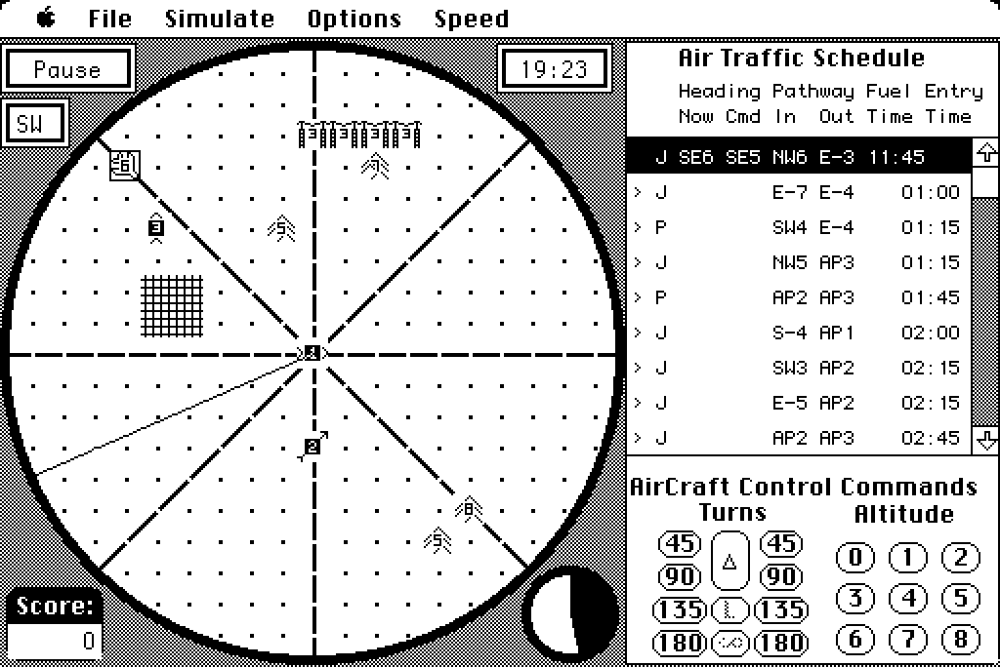
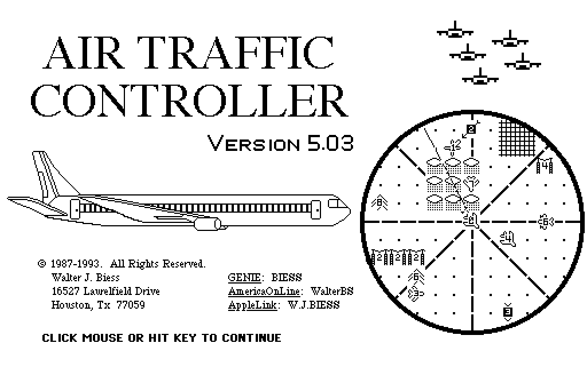
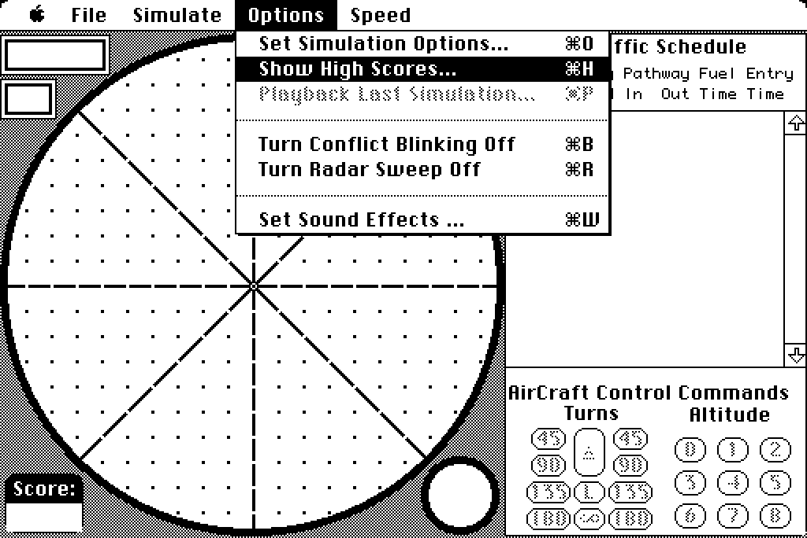
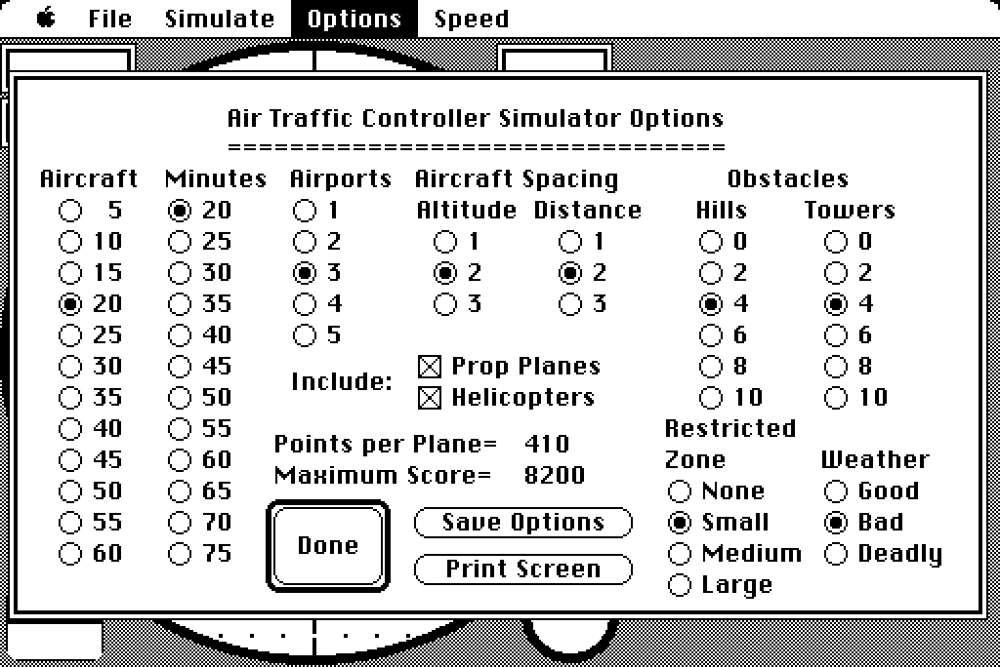
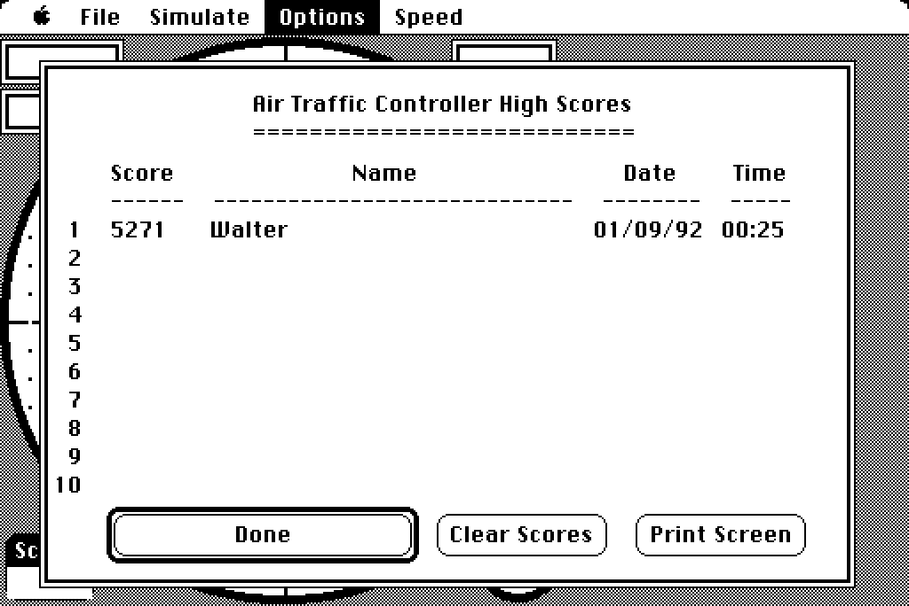
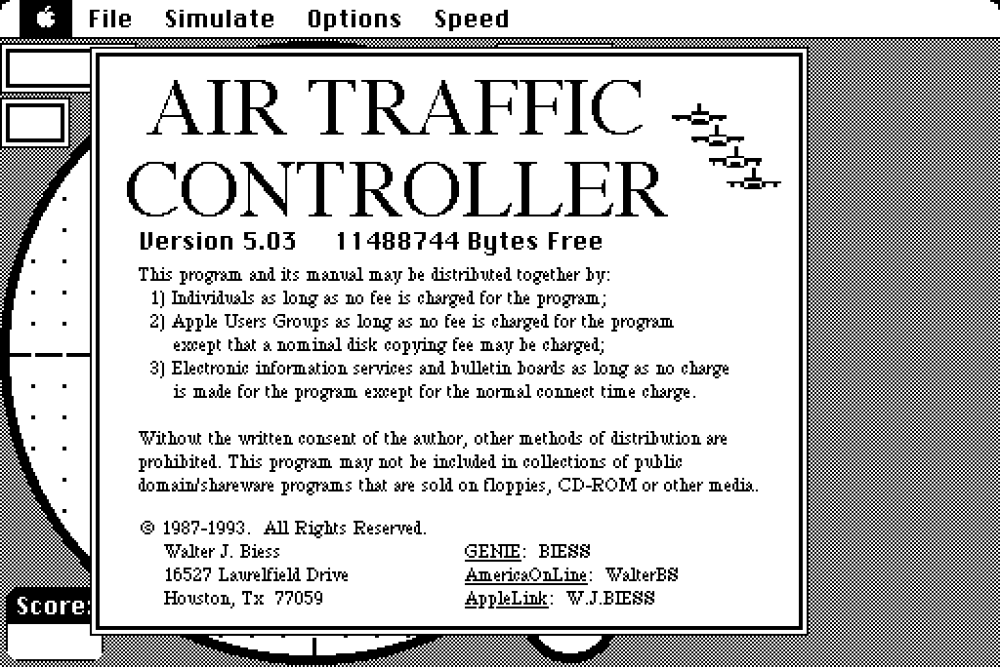
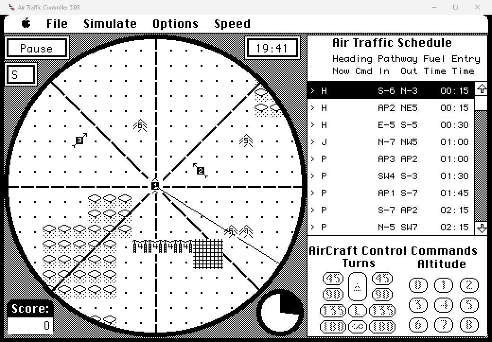

# Air Traffic Controller 5.03 — for Windows, macOS and Linux

A native port of **Air Traffic Controller 5.03**, Walter J. Biess's classic Macintosh
air traffic control simulator (1986–1993) and the freeware successor of *Near Miss*.

The game is not rewritten or re-imagined: its **original 68k code runs unchanged** on an
embedded CPU core, and every call it makes into the classic Mac OS — windows, menus,
dialogs, QuickDraw graphics, fonts, files, sound — is answered by a compact C
reimplementation of those parts of the Mac Toolbox. It looks, sounds and plays exactly
like it did on a 1993 Macintosh, in a resizable window on a modern computer.

## Contents

- [Download](#download)
- [The game](#the-game)
- [How to play](#how-to-play)
- [Screenshots](#screenshots)
- [What works](#what-works)
- [Building from source](#building-from-source)
- [How it works](#how-it-works)
- [Credits and legal](#credits-and-legal)
- [License](#license)

## Download

Get the latest build from the [Releases](../../releases/latest) page. **Everything is in
one file** — the game is built into the program, so there is nothing else to download,
install or set up.

| System | Download | To play |
|---|---|---|
| **Windows** 10 or 11, 64-bit | `ATC-Windows-x64.exe` | Run it. (`ATC-Windows-x64.zip` is the same program with the manual and this README.) |
| **macOS** 10.13 or later, Apple silicon and Intel | `ATC-macOS-universal.dmg` or `.zip` | Drag *Air Traffic Controller* to Applications and open it. The app is not notarized, so the first time **right-click it and choose Open** (or run `xattr -dr com.apple.quarantine "/Applications/Air Traffic Controller.app"`). |
| **Linux** x86_64 | `ATC-Linux-x86_64.AppImage` | `chmod +x ATC-Linux-x86_64.AppImage`, then run it. (`ATC-Linux-x86_64.tar.gz` holds a plain `atc` binary, desktop entry, icon and manual.) Opening and saving schedules uses `zenity` or `kdialog`. |

The Windows program needs no runtime libraries; the macOS and Linux programs have SDL
built in.

## The game

**Air Traffic Controller 5.03** was released by its author, Walter J. Biess, as freeware;
its terms allow it to be passed on free of charge together with its manual. It is
included in this repository as [`data/ATC.rsrc`](data) (the application's resource fork)
with its manual, [`data/Manual.txt`](data/Manual.txt), and both are compiled into every
build. The program also writes the manual into its save folder the first time it runs.

### Fonts

The game draws its text in three classic Mac bitmap fonts: Chicago 12 (menus, dialogs,
buttons), Monaco 9 (the schedule) and Monaco 12 (clock, score, wind). Apple's fonts are
not included; instead the port has its own stand-ins — **Tower 12**, **Radar 9** and
**Radar 12** — drawn from scratch for this project as pixel art in [`fonts/`](fonts) and
compiled into the program by `tools/build_fonts.py`. Every character has exactly the
advance width of the font it replaces, so all text lands on the same pixels and the
layout is unchanged.

To see Apple's originals instead, put a System 6 *System* file (raw resource fork,
AppleDouble or MacBinary — for example `hcopy -m System System.bin` from a disk image
with [hfsutils](https://www.mars.org/home/rob/proj/hfs/)) next to the program, or in the
user data folder, named `System.rsrc`, `System` or `System.bin`. `ATC_BUILTIN_FONTS=1`
forces the built-in fonts.

### Using another copy of the game

`ATC <folder>` (or `ATC_GAME=<folder>`) runs a copy of the game from a folder instead of
the built-in one. The folder holds the application's resource fork in any of three forms —
a **MacBinary** file, an **AppleDouble** file (what `unar -k visible` writes when
unpacking the original `.sit`), or a **raw resource fork** — and, optionally, a System
file for its fonts; files are recognised by their contents, whatever their names.
`tools/rfork.py extract <in> <out>` converts any of the forms to a raw fork.

## How to play

You are in charge of all the air traffic in your sector for one shift. Every aircraft on
the **schedule** must leave through its assigned exit — a compass point at a set altitude,
or an airport — before its fuel runs out, without coming too close to other aircraft.
Aircraft move once per **turn** (15 seconds): jets every turn, propeller planes every
second turn, helicopters every fourth.

1. **Start a shift** with *Simulate ▸ With New Schedule* (Command-N).
2. **Select an aircraft**: click it on the radar, or click its line in the schedule.
3. **Give it a command** from the *Aircraft Control Commands* panel:
   * **Turns** of 45°, 90°, 135° or 180° left or right; **Δ** flies straight on; **∞**
     circles (only while already turning).
   * **Altitude** levels **0–8**; aircraft climb or descend one level per move. **L**
     lands at the destination airport when the path crosses it (only at or bound for
     level 1). Aircraft waiting at an airport (**Δ** on the schedule) take off when given
     an altitude.
4. Watch for **near misses** (aircraft too close in altitude and distance, or flying through
   the restricted zone) and **thunderstorms** — both cost points. Collisions, hitting hills
   or towers, running out of fuel or landing from the wrong direction end in a crash.

The schedule's columns show the aircraft type (**J**et, **P**rop, **H**elicopter),
current heading and altitude, commanded heading and altitude, entry and exit points, fuel
time and entry time. Click the **Pause** box to stop the clock; click the **turn timer**
(the small circle) or the **shift clock** to skip ahead one turn. Holding the mouse
button on the edge of the radar previews aircraft about to enter there.
*Options ▸ Set Simulation Options* sets the number of aircraft, shift length, airports,
separation, obstacles, restricted zone and weather; the full manual comes with the game.

### Keyboard

**Command** is **Ctrl** on Windows and Linux and **⌘** on macOS. **Option** is **Alt/Option**.

| Keys | Menu command |
|---|---|
| Command-N / Command-C | Simulate with a new / the current schedule |
| Command-E | End simulation |
| Command-L / Command-S | Load / save schedule |
| Command-O | Set simulation options |
| Command-H | Show high scores |
| Command-P | Play back the last simulation |
| Command-B / Command-R | Conflict blinking / radar sweep on or off |
| Command-W | Sound effects |
| Command-G / Command-F | Faster / fastest (any click or key returns to normal speed) |
| Command-A | About |
| Command-Q | Quit |

### Window and saved data

* The window can be resized freely; the picture is scaled by whole pixels so it stays sharp.
  Set `ATC_SCALE=3` (or any number) to choose the starting size.
* Settings, high scores and saved schedules are kept in a `save` folder:

  | System | Location |
  |---|---|
  | Windows | a `save` folder next to the program; if that isn't writable, `%APPDATA%\Air Traffic Controller\save` |
  | macOS | `~/Library/Application Support/Air Traffic Controller/save` |
  | Linux | `~/.local/share/air-traffic-controller/save` (or under `$XDG_DATA_HOME`) |

## Screenshots

| | |
|---|---|
|  |  |
| *Title screen* | *Menus, with their original keyboard shortcuts* |
|  |  |
| *Simulation options* | *High scores* |
|  |  |
| *About box* | *Running in a Windows window* |

## What works

Everything a player touches: the title screen; starting, playing and ending shifts;
selecting aircraft on the radar or schedule; all turn, altitude, landing and circling
commands; the radar sweep and conflict blinking; weather, hills, towers and restricted
zones; the schedule with its scroll bar; the shift clock, wind, score and turn timer;
pause and skip-a-turn; simulation options; high scores (saved); the
About box; sound effects; and loading and saving schedules through the system's own file
dialogs.

Known limitations:

* **Black and white.** The game is told it is running on a Mac without Color QuickDraw,
  so the *Set Icon Colors* and *Set Text Options* (large-screen) menu items don't appear —
  exactly as on a compact Mac.
* **Printing** (*Print Display / Poster / Schedule*) is reported as unavailable.
* **Near Miss 1.0**, the earlier commercial version, spoke its messages through MacinTalk;
  that version isn't supported (5.03 has no speech).

## Building from source

| System | Requirements | Build |
|---|---|---|
| Windows | Visual Studio 2019/2022 or the Build Tools ("Desktop development with C++") | `build.bat` (development build with a console for logs), or `cmake -S . -B b -A x64 && cmake --build b --config Release` |
| macOS | Xcode command-line tools, CMake | `cmake -S . -B b -DCMAKE_BUILD_TYPE=Release && cmake --build b` → `b/Air Traffic Controller.app` |
| Linux | gcc or clang, CMake, and the X11/Wayland/ALSA/PulseAudio development packages SDL needs | the same commands → `b/atc` |

On macOS and Linux CMake downloads SDL2 and links it statically, so the result has no
SDL dependency; `-DATC_FETCH_SDL=OFF` uses an installed SDL2 instead. For a universal
macOS build add `-DCMAKE_OSX_ARCHITECTURES="arm64;x86_64"`.

Releases are built by [`.github/workflows/release.yml`](.github/workflows/release.yml):
pushing a `v*` tag builds all three packages and publishes them as a GitHub release
(running the workflow by hand builds them as artifacts only).

## How it works

The game is a Lightspeed Pascal application in 15 code segments. The port loads them,
builds the A5 world and jump table exactly as the Mac's Segment Loader did, and runs the
code on [Musashi](https://github.com/kstenerud/Musashi) as a 68020. Every Toolbox or OS
call is an A-line trap: the CPU core hands it to the dispatcher, which implements it in C
on top of an emulated 16 MB address space — where windows, menus, regions, handles and
QuickDraw ports live in their real Mac layouts, because the game reads and writes their
fields directly.

| Source | Job |
|---|---|
| `src/trap.c` | A-line trap dispatch, calls back into 68k code, Memory Manager and OS utility traps |
| `src/mem.c` | Emulated RAM and the Memory Manager (handles and pointers) |
| `src/rsrc.c` | Resource Manager over resource-fork files, with a settings overlay for what the game writes back |
| `src/qd.c`, `rgn.c`, `font.c` | 1-bit QuickDraw: ports, pens, patterns, shapes, true regions, text in classic Mac bitmap fonts, CopyBits and PICT playback |
| `fonts/`, `src/fonts_builtin.c` | The built-in fonts: pixel-art sources and the FONT data generated from them |
| `src/wm.c` | Window Manager with real visible regions and update events; standard frames drawn natively, the game's own round-window definition (WDEF) runs as 68k code |
| `src/menu.c`, `dlg.c`, `ctl.c` | Menu bar and menus, dialogs and alerts, buttons, check boxes, radio buttons and scroll bars |
| `src/evt.c` | Event Manager (activate, mouse, keyboard and update events) |
| `src/fs.c`, `pack.c` | File Manager over a host folder, Standard File through native dialogs, SANE, the Sound Manager and Sound Driver |
| `src/plat.c` | Portability layer (files, folders, user data locations) |
| `src/host_win.c`, `audio_win.c` | Windows host: window, input, cursors, icon, dialogs and waveOut audio |
| `src/host_sdl.c` | macOS and Linux host on SDL2 |
| `tools/` | Resource-fork extraction, a 68k disassembler and trap audit for the game, the font compiler, screenshot conversion, the icon generator |

### Debugging

Environment variables switch on logging and testing aids:

| Variable | Effect |
|---|---|
| `ATC_TRACE=1` | log every trap |
| `ATC_PCLOG=n,count` | log `count` instructions after trap number `n` |
| `ATC_WINLOG`, `ATC_EVLOG`, `ATC_TEXTLOG`, `ATC_CBLOG`, `ATC_SEGLOG`, `ATC_COMPLOG` | log windows, events, text drawing, CopyBits, segment loading, window composition |
| `ATC_GAME=<folder>`, `ATC_SAVE=<folder>` | game and save folders |
| `ATC_BUILTIN_FONTS=1` | use the built-in fonts even when a System file is present |
| `ATC_NOSOUND=1`, `ATC_WAVDUMP=file.wav` | no sound / record the sound output (Windows) |
| `ATC_HIDDEN=1` | run without showing the window |
| `ATC_SCRIPT="ms:action;..."` | scripted input for headless tests: `click x y`, `down x y`, `move x y`, `up x y`, `key c`, `cmd c`, `dump file.pbm`, `quit` |

`tools/pbm2png.py` converts the `dump` screenshots to PNG.

## Credits and legal

* **Air Traffic Controller** © 1986–1993 Walter J. Biess. Released as freeware; its own
  terms allow free distribution together with its manual, and it is included here on
  those terms (see [THIRD_PARTY_NOTICES.md](THIRD_PARTY_NOTICES.md)). This project is not
  affiliated with its author.
* **Macintosh system fonts** © Apple. They are not included; the program can read them
  from a System file you provide. The built-in fonts (Tower 12, Radar 9, Radar 12) are
  original work of this project.
* **Musashi** 68000 core © 1998–2002 Karl Stenerud, MIT licence (see `musashi/readme.txt`).
  It includes SoftFloat by John R. Hauser (see `musashi/softfloat/README.txt`).
* **SDL 2** (macOS and Linux builds) © Sam Lantinga, zlib licence.
* Port by **KurdtNervanna**.

## License

The port's own code and its built-in fonts are released under the [MIT License](LICENSE).
It does not cover the game (included under its author's own freeware terms), Apple's
fonts (not included) or the bundled third-party components,
which keep their own licences; see [THIRD_PARTY_NOTICES.md](THIRD_PARTY_NOTICES.md).
